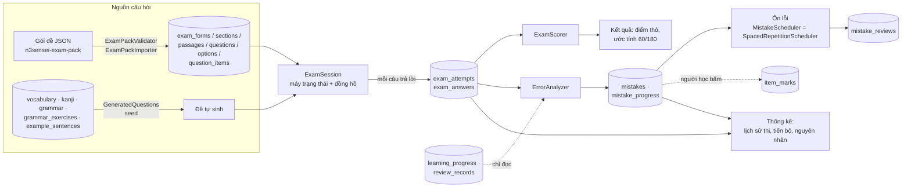

# Kế hoạch module JLPT Exam & Intelligent Error Analysis

Khảo sát ngày 2026-11-05 trên code hiện tại: commit `f79338e` cùng 132 file thay đổi chưa commit
(đợt Design System → Trang chủ), schema Room **v8**. Tài liệu này chỉ là kế hoạch: chưa có dòng
source code nào được sửa.

---

## 0. Ba điều cần bạn quyết định trước khi lập trình

1. **Nguồn câu hỏi thi.** Dữ liệu hiện tại **không có câu hỏi thi nào**:
   - gói ngữ pháp N3 có 174 mẫu nhưng 0 bài tập;
   - chỉ gói minh họa có 7 bài tập trắc nghiệm;
   - không có đoạn đọc hiểu, không có audio nghe hiểu.

   Đề thi JLPT chính thức (JEES/Japan Foundation) có bản quyền, nên app không thể tự đóng gói.
   Có ba nguồn khả thi, có thể kết hợp:
   - **A. Gói đề do bạn biên soạn hoặc có quyền**, nhập bằng tệp JSON (giống gói nội dung).
     Đây là cách duy nhất để có Đọc hiểu và Nghe hiểu thật.
   - **B. Đề luyện tự sinh** từ dữ liệu đang có: cách đọc Kanji, chọn chữ Kanji đúng, nghĩa từ,
     điền mẫu ngữ pháp vào câu ví dụ. Chỉ phủ phần 文字・語彙 và một phần 文法. Đề phải ghi rõ
     là đề luyện tự tạo, không phải đề JLPT.
   - **C. Cả A và B** (đề xuất): B dùng được ngay; A bổ sung dần.
2. **Nghe hiểu (聴解).** Cần tệp audio trong gói đề, nghĩa là app phải có trình phát audio và
   gói nặng hơn. Đề xuất để sang **giai đoạn sau**, khi đã có gói đề kèm audio hợp lệ.
3. **Thang điểm.** JLPT chấm theo **điểm quy đổi (scaled score)** bằng phương pháp IRT, không
   công khai công thức.

   | Phần | Điểm |
   |---|---|
   | 言語知識 (文字・語彙・文法) | 0–60 |
   | 読解 | 0–60 |
   | 聴解 | 0–60 |

   Tổng 180, đỗ khi đạt 95 và mỗi phần ít nhất 19. App chỉ tính được **điểm thô và tỉ lệ đúng**.
   Đề xuất hiển thị điểm thô, kèm một **ước tính theo thang 60/180 được gắn nhãn "Ước tính"**,
   giống cách Trang chủ/Thống kê đang làm. Tuyệt đối không gọi đó là "điểm JLPT".

---

## 1. Kiến trúc hiện tại (đã kiểm tra)

### 1.1 Công nghệ

| Thành phần | Phiên bản / cách dùng |
|---|---|
| Ngôn ngữ, build | Kotlin 2.0.21, AGP 8.13.2, Gradle 8.13, JDK 17, KSP |
| SDK | minSdk 26 (Android 8), target/compile 36 |
| UI | Jetpack Compose (BOM 2024.11.00), Material 3, `material-icons-core` |
| Navigation | Navigation Compose 2.8.4, route type-safe `@Serializable` |
| Dữ liệu | Room 2.6.1 (schema export, migration tay), DataStore Preferences |
| Khác | kotlinx.serialization, WorkManager 2.10, Glance 1.1.1 |
| DI | Thủ công: `AppContainer` / `DefaultAppContainer`, `appViewModel { … }`. Không có Hilt. |
| Test | JUnit4, coroutines-test, Room testing (`MigrationTestHelper`), Compose UI test, WorkManager testing |

Module Gradle: chỉ có **một module `:app`**. Phân tầng bằng package, và
`ArchitectureRulesTest` cưỡng chế các quy tắc sau:
- `feature/*` và `core/ui` không import `data`;
- các feature không import lẫn nhau và không import navigation;
- `domain` là Kotlin thuần.

### 1.2 Package

```
app/            MainActivity, N3SenseiApp/Root, di/AppContainer, navigation/, reminder/, widget/
core/designsystem/   theme (Color, Type, Spacing, Motion), component (N3Card, SectionCard, Tag,
                     Caption, N3ProgressBar, GlyphTile, FuriganaText, DailyBarChart, StackedBar…)
core/ui/        content/ (Flashcard, *Card, StudyColors, ItemLocationViews…), state/ (UiState,
                UiStateContent, DashboardViewModel, ItemBrowserViewModel, DetailLocation…)
data/           local/ (N3Database, N3Migrations, dao/, entity/), repository/, importing/,
                backup/, preferences/, proverb/
domain/         model/, repository/ (interface), srs/, analytics/, forecast/, course/, practice/,
                edit/, reminder/, widget/, proverb/, backup/, importing/, furigana/
feature/        home, learn, lessons, vocabulary, kanji, grammar, edit, practice, review,
                reviewsession, stats, settings, onboarding
```

### 1.3 Điều hướng

- `Scaffold` có top bar và **5 tab**: Trang chủ, Học, Ôn tập, Thống kê, Cài đặt. Material
  khuyến nghị tối đa 5 tab, nên **không thêm tab thứ 6**.
- `AppScreen` đăng ký mọi màn lá (tiêu đề, tab sở hữu, `isFocusSession` để ẩn tab bar trong
  phiên học). `AppScreenTest` và `N3SenseiNavigationTest` kiểm danh sách này.
- `N3SenseiNavHost` tạo ViewModel từ container và truyền callback. Feature không thấy
  `NavController`.
- Deep link `n3sensei://vocabulary|kanji|grammar/{id}` (từ thông báo và widget).

### 1.4 Database Room (v8)

**Nội dung**: mỗi gói xóa rồi chèn lại khi cập nhật.

| Bảng | Ghi chú |
|---|---|
| `content_sources`, `content_packs`, `lessons` | |
| `vocabulary`, `kanji`, `grammar` | Mỗi mục thuộc một `lesson_id` |
| `grammar_exercises` | `prompt`, `options` (list), `answer_index`, `explanation_vi`; FK grammar |
| `example_sentences` | |
| `vocabulary_examples`, `kanji_examples`, `grammar_examples` | Bảng nối |
| `tags`, `vocabulary_tags` | |

**Dữ liệu người học**: khóa theo `(item_type, item_id)`, không có FK, nên sống sót qua mọi
lần cập nhật gói.

| Bảng | Ghi chú |
|---|---|
| `learning_progress` | Trạng thái SRS |
| `review_records` | Mỗi câu trả lời một dòng; `request_id` unique, chống ghi trùng |
| `item_marks` | Đánh dấu "cần chú ý" |
| `review_sessions` | |
| `user_content_edits` | |
| `vocabulary_kanji_links`, `user_words`, `user_kanji_examples` | |
| `reminder_history` | |

`ItemType` = {VOCABULARY, KANJI, GRAMMAR}. Giá trị này đi qua mọi truy vấn tiến độ và thống kê
(`ProgressDao` có SQL `UNION` theo từng loại, `OfflineAnalyticsRepository` dùng
`ItemType.entries`) và các nhánh `when` trong UI.

Nâng cấp: `N3Migrations.ALL` (1→…→8), schema JSON trong `app/schemas/`, và
`N3DatabaseMigrationTest` kiểm mọi phiên bản lên bản hiện tại kèm test dữ liệu cho từng bước.
**Không dùng destructive migration.** Đợt trước đã thử nâng cấp thật v6→v8 trên emulator.

### 1.5 Học, ôn và thống kê

- **SRS:**
  - `SpacedRepetitionScheduler(ladder)` có `schedule()` và `preview()`; thang mặc định
    20 phút, 1 giờ, 1 ngày, 2 ngày, 1 tuần, 2 tuần, 1 tháng; 4 nút đánh giá.
  - `SubmitReviewUseCase` và `ProgressRepository.submitReview/recordReview` ghi tiến độ và
    lịch sử trong một transaction.
- **Phiên học:** `PracticeSession` (luyện tập, không ghi lịch); `ReviewSessionViewModel` (ghi
  lịch). Cả hai dùng chung `FlashcardSession`.
- **Bài học:** `CourseBuilder` (24 Kanji / 30 từ / 7 ngữ pháp mỗi bài), `VocabularyGroups`,
  `ItemLocations`. Tất cả tính khi hiển thị, không lưu.
- **Thống kê:**
  - `AnalyticsRepository` (hoạt động, đến hạn, trạng thái theo loại, xu hướng, mục khó…);
  - `DashboardViewModel` dùng chung cho Trang chủ và Thống kê;
  - `StatsViewModel`;
  - các nhãn "Thực tế / Ước tính".
- **Nhập dữ liệu:**
  - `ContentPackJsonParser` → `ContentPackValidator` (báo cáo từng mục bị bỏ, kèm lý do) →
    `ContentPackImporter` (chỉ thay đúng gói đó);
  - định dạng `n3sensei-content-pack` v1; trường lạ được bỏ qua.
- **Sao lưu JSON:** tiến độ, lịch sử, đánh dấu, phiên ôn, cài đặt. Chưa gồm dữ liệu người dùng
  tạo (đã ghi là việc còn tồn).

### 1.6 Design System

Màu rêu/giấy/mực, đủ vai trò M3 cho cả sáng và tối, có `ColorContrastTest`. Chữ: serif cho
display/headline, `japanese()` cho chữ Nhật. Token `N3Spacing`, `N3Motion` (có giảm chuyển
động). Component: `N3Card`, `SectionCard`, `Tag`, `Caption`, `N3ProgressBar`, `StudyColors`
(màu đánh giá và trạng thái), `InfoBanner`, `UiStateContent` (loading/empty/error).

---

## 2. Kiến trúc đề xuất

Nguyên tắc: **thêm, không sửa**.
- Màn hình và logic cũ giữ nguyên. Chỉ thêm điểm vào (một mục ở Học → Trung tâm và một thẻ ở
  tab Ôn tập), thêm route và thêm thẻ ở Thống kê.
- Không thêm `ItemType` mới. Lỗi sai có bảng SRS riêng, nhưng dùng lại đúng
  `SpacedRepetitionScheduler`.
- Câu hỏi thi tham chiếu tới từ vựng/Kanji/ngữ pháp hiện có qua `ItemRef`, không sao chép nội
  dung.
- Vẫn một module Gradle, theo đúng phân tầng hiện tại. Không thêm Hilt hay thư viện mới. Audio
  (giai đoạn sau) dùng `MediaPlayer` của Android, không cần ExoPlayer.

### 2.1 Package

```
domain/exam/
    ExamModels.kt          Section, QuestionType, Question, Option, ExamForm, ExamAttempt, Answer,
                           AttemptResult, ErrorCause, MistakeEntry
    ExamBlueprint.kt       Cấu trúc đề N3 (phần, dạng câu, thời gian), dữ liệu cấu hình, không cứng trong UI
    ExamScorer.kt          Chấm điểm thô theo phần; ước tính thang 60/180 (nhãn Ước tính)
    ErrorAnalyzer.kt       Phân loại nguyên nhân sai theo quy tắc (không AI)
    GeneratedQuestions.kt  Sinh câu hỏi từ dữ liệu hiện có (nguồn B), có seed để tái lập
    MistakeScheduler.kt    Bọc SpacedRepetitionScheduler cho lỗi sai
    ExamSession.kt         Máy trạng thái phiên thi (thuần, test được như PracticeSession)
domain/repository/
    ExamRepository.kt, MistakeRepository.kt, ExamPackImportRepository.kt (interface)
data/exam/
    ExamPackParser.kt, ExamPackValidator.kt, ExamPackImporter.kt
data/local/entity/ExamEntities.kt
data/local/dao/ExamDao.kt, MistakeDao.kt
data/repository/OfflineExamRepository.kt, OfflineMistakeRepository.kt
feature/exam/
    ExamHubScreen + ExamHubViewModel                Chọn đề hoặc kỹ năng, lịch sử thi
    ExamSessionScreen + ExamSessionViewModel        Làm bài có đồng hồ (phiên tập trung)
    ExamResultScreen + ExamResultViewModel          Điểm, phân tích theo phần, dạng câu, nguyên nhân
    ExamReviewScreen                                Xem lại từng câu, đáp án, giải thích
feature/mistakes/
    MistakeNotebookScreen + MistakeNotebookViewModel   Sổ tay lỗi (lọc theo phần, nguyên nhân, mục)
    MistakeReviewScreen + MistakeReviewViewModel       Ôn lỗi theo SRS (dùng lại FlashcardSession nếu hợp)
core/ui/content/ExamQuestionCard.kt   Hiển thị câu hỏi (furigana, gạch chân, lựa chọn); dùng chung
```

### 2.2 Dữ liệu đề: tái sử dụng hay thêm mới

| Nhu cầu | Đã có | Đề xuất |
|---|---|---|
| Từ vựng, Kanji, ngữ pháp mà câu hỏi kiểm tra | `vocabulary`, `kanji`, `grammar` | **Tham chiếu** qua `exam_question_items(question_id, item_type, item_id)`, không sao chép |
| Câu trắc nghiệm ngữ pháp | `grammar_exercises` (gắn một mẫu ngữ pháp) | Giữ nguyên cho trang Ngữ pháp. Bộ sinh đề (B) **đọc** bảng này làm nguồn; câu thi lưu riêng vì cần thêm phần, dạng câu, đoạn văn, lý do của từng phương án |
| Câu ví dụ | `example_sentences` | Bộ sinh đề dùng làm ngữ cảnh điền mẫu ngữ pháp |
| Gói và nguồn, giấy phép | `content_packs`, `content_sources` | Gói đề **dùng chung** hai bảng này (cột `kind` phân biệt gói nội dung và gói đề), kế thừa cơ chế nguồn/giấy phép và báo cáo nhập |
| SRS | `SpacedRepetitionScheduler`, `ReviewLadder` | **Dùng lại**; trạng thái lỗi lưu ở `mistake_progress` |
| Đánh dấu mục cần chú ý | `item_marks` | Từ một lỗi, người học **bấm** "Đánh dấu từ/Kanji/mẫu này" thì ghi vào `item_marks`. Không tự động: lịch ôn hiện có không bị bài thi tác động ngầm |
| Phiên | `review_sessions` | Không dùng chung (nghĩa khác); thêm `exam_attempts` |

### 2.3 Schema đề xuất: v8 → v9 (một migration, chỉ `CREATE TABLE` và `CREATE INDEX`)

Nhóm **nội dung đề** (xóa/chèn lại theo gói, giống nội dung học):

```sql
exam_forms(            -- một đề (hoặc bộ câu cho một kỹ năng)
  id TEXT PK, pack_id TEXT FK→content_packs ON DELETE CASCADE, source_id TEXT FK→content_sources,
  title TEXT, level TEXT ('N3'), kind TEXT ('FULL'|'SECTION'|'GENERATED'), sort_order INT)
exam_sections(
  id TEXT PK, form_id TEXT FK→exam_forms CASCADE, section TEXT ('VOCABULARY'|'GRAMMAR'|'READING'|'LISTENING'),
  time_limit_seconds INT, sort_order INT)
exam_passages(         -- đoạn đọc hiểu, script/tệp audio nghe hiểu
  id TEXT PK, section_id TEXT FK CASCADE, text TEXT NULL, furigana TEXT NULL, audio_asset TEXT NULL, sort_order INT)
exam_questions(
  id TEXT PK, section_id TEXT FK CASCADE, passage_id TEXT NULL FK→exam_passages,
  type TEXT,           -- KANJI_READING, ORTHOGRAPHY, CONTEXT, PARAPHRASE, USAGE, GRAMMAR_FORM,
                       -- SENTENCE_ORDER, TEXT_GRAMMAR, READING_*, LISTENING_*
  prompt TEXT, prompt_furigana TEXT NULL, underline_start INT NULL, underline_end INT NULL,
  answer_index INT, explanation_vi TEXT NULL, sort_order INT)
exam_options(
  question_id TEXT FK CASCADE, idx INT, text TEXT,
  distractor TEXT NULL,      -- mã lý do phương án sai này dễ bị chọn: SIMILAR_KANJI, LONG_VOWEL,
                             -- VOICING, SIMILAR_MEANING, WRONG_CONJUGATION, WRONG_PARTICLE…
  PRIMARY KEY(question_id, idx))
exam_question_items(         -- mục học mà câu hỏi kiểm tra (0..n), khóa mềm, không FK
  question_id TEXT FK CASCADE, item_type TEXT, item_id TEXT, PRIMARY KEY(question_id, item_type, item_id))
```

Nhóm **dữ liệu người học**: không có FK tới nội dung, sống sót qua cập nhật gói, giống
`learning_progress`.

```sql
exam_attempts(
  id TEXT PK, form_id TEXT, form_title TEXT,            -- tiêu đề chép lại để lịch sử vẫn đọc được nếu gói bị gỡ
  mode TEXT ('FULL'|'SECTION'|'PRACTICE'), sections TEXT, started_at INT, finished_at INT NULL,
  time_limit_seconds INT, state TEXT ('IN_PROGRESS'|'FINISHED'|'ABANDONED'), seed INT NULL)
exam_answers(
  attempt_id TEXT FK→exam_attempts CASCADE, question_id TEXT, chosen_index INT NULL,
  correct_index INT, is_correct INT, time_spent_ms INT, changed_count INT, flagged INT,
  answered_at INT, cause TEXT NULL,        -- nguyên nhân do ErrorAnalyzer gán (hoặc người học sửa)
  question_snapshot TEXT NULL,             -- JSON câu hỏi lúc thi: cho câu tự sinh, hoặc khi gói đổi/bị gỡ
  PRIMARY KEY(attempt_id, question_id))
mistakes(                -- sổ tay: một dòng cho mỗi câu hỏi từng làm sai
  question_id TEXT PK, first_wrong_at INT, last_wrong_at INT, wrong_count INT, right_count INT,
  cause TEXT, note TEXT NULL, archived INT DEFAULT 0, question_snapshot TEXT)
mistake_progress(        -- SRS của lỗi, cùng thang và cùng scheduler với ôn tập
  question_id TEXT PK, state TEXT, step_index INT, interval_minutes INT, due_at INT NULL,
  last_reviewed_at INT NULL, review_count INT, lapse_count INT, created_at INT, updated_at INT)
mistake_reviews(         -- lịch sử ôn lỗi; request_id unique, chống ghi trùng như review_records
  id INTEGER PK AUTOINCREMENT, question_id TEXT, rating TEXT, reviewed_at INT, request_id TEXT UNIQUE)
```

Index: `exam_questions(section_id)`, `exam_answers(question_id)`, `exam_attempts(started_at)`,
`mistake_progress(due_at)`, `exam_question_items(item_type, item_id)`.

Vì sao có `question_snapshot`:
- câu tự sinh (B) không nằm trong `exam_questions`;
- gói đề cập nhật có thể sửa hoặc xóa câu.

Lịch sử thi và sổ tay lỗi không được mất hay đổi nghĩa trong các trường hợp đó. Đây đúng là
cách app đang giữ tiến độ khi nội dung thay đổi.

### 2.4 Phân tích nguyên nhân sai (theo quy tắc, không AI)

`ErrorAnalyzer` gán **một nguyên nhân chính** cho mỗi câu sai, ưu tiên theo thứ tự:

1. **Hết giờ / bỏ trống**: không chọn, hoặc chọn sau khi hết giờ phần thi.
2. **Đoán vội**: thời gian trả lời dưới ngưỡng (ví dụ dưới 25% thời gian trung bình của dạng
   câu đó).
3. **Đổi sai**: từng chọn đúng rồi đổi sang sai (`changed_count` cùng lịch sử lựa chọn trong
   phiên).
4. **Bẫy phương án**: phương án đã chọn có mã `distractor` (Kanji giống nhau, trường âm, âm đục,
   nghĩa gần, chia sai, trợ từ…). Mã này do người soạn đề gán; câu tự sinh thì bộ sinh tự gán,
   vì nó biết phương án nhiễu được tạo bằng cách nào.
5. **Chưa nắm mục học**: mục liên kết (`exam_question_items`) còn NEW, hoặc đang có
   `lapse_count` cao, hoặc từng sai trong ôn tập. Đọc từ `learning_progress` và
   `review_records`, **không ghi** vào đó.
6. **Chưa xác định**: không quy tắc nào khớp. Người học có thể tự chọn lại nguyên nhân trong
   sổ tay.

Kết quả thi tổng hợp theo phần, dạng câu, nguyên nhân và mục học. Ví dụ:
- "6/8 câu 漢字読み; 3 lỗi do trường âm";
- danh sách mục học hay sai, mở được trang chi tiết bằng các route hiện có.

### 2.5 Ôn lỗi theo Spaced Repetition

- Câu sai lần đầu được thêm vào `mistakes` và tạo `mistake_progress`, đến hạn ngay.
- **Ôn lỗi:**
  - hiện lại câu hỏi;
  - người học chọn đáp án (chấm tự động), rồi đánh giá Quên/Khó/Tốt/Dễ;
  - mặc định là Quên nếu chọn sai, gợi ý Tốt nếu chọn đúng.

  `MistakeScheduler` gọi `SpacedRepetitionScheduler.schedule()` với thang đang cài trong
  `ReviewSettings`, nên khoảng ôn giống hệt phần Ôn tập.
- **Lưu trữ lỗi:** khi lỗi đạt bậc cuối của thang (giống "thành thạo"), nó được chuyển vào
  "Đã nắm". Lỗi được lưu trữ, không bị xóa.
- **Không đụng tiến độ học hiện có:** ôn lỗi không thay đổi `learning_progress` hay
  `review_records`. Liên kết duy nhất là người học tự bấm "Đánh dấu mục này" (ghi vào
  `item_marks`, như nút "Cần học lại" của thông báo).

### 2.6 Màn hình và điều hướng

Không thêm tab:

| Điểm vào | Thay đổi |
|---|---|
| Học → Trung tâm | Thêm một dòng "Thi thử JLPT" (`LearnHubScreen` thêm một mục, như "Từ của tôi") |
| Ôn tập | Thêm thẻ "Lỗi sai cần ôn (n)" mở `MistakeReviewRoute` |
| Thống kê | Thêm các thẻ: Lịch sử thi, Tiến bộ theo phần, Nguyên nhân sai hay gặp |

Route mới (`@Serializable`, đăng ký trong `AppScreen`):
- `ExamHubRoute`;
- `ExamSessionRoute(formId, sections, mode)` với `isFocusSession = true`;
- `ExamResultRoute(attemptId)`;
- `ExamReviewRoute(attemptId)`;
- `MistakeNotebookRoute`;
- `MistakeReviewRoute` với `isFocusSession = true`.

Kết quả và xem lại đọc theo `attemptId`, nên vẫn mở được sau khi đóng và mở lại app.

**Làm bài có đồng hồ:**
- Đồng hồ tính từ `started_at` lưu trong Room và `Clock`, không đếm trong bộ nhớ. Quay app vào
  nền, xoay màn hình hay bị hệ thống kết thúc tiến trình đều không làm sai thời gian.
- Mỗi câu trả lời ghi ngay vào `exam_answers`, nên mở lại app thì làm tiếp đúng chỗ.
- Khi hết giờ: phần thi khóa lại, câu chưa làm tính là bỏ trống.
- Không có thông báo hay tác vụ nền chạy trong lúc thi.

### 2.7 Offline-first

- Toàn bộ đề, bài làm, sổ tay và SRS nằm trong Room. App không có quyền INTERNET và kế hoạch
  không thêm quyền này.
- Gói đề nhập bằng trình chọn tệp hệ thống, như gói nội dung.
- Audio (giai đoạn sau): tệp đi kèm gói, được chép vào bộ nhớ trong của app khi nhập.
- Câu tự sinh không cần dữ liệu ngoài. Seed được lưu trong `exam_attempts` để tái lập được đề.

### 2.8 Sơ đồ luồng dữ liệu



---

## 3. File cần tạo và chỉnh sửa

### 3.1 Tạo mới

| File | Nội dung |
|---|---|
| `domain/exam/*.kt` (7 file, mục 2.1) | Model, cấu trúc đề, chấm điểm, phân tích lỗi, sinh câu, SRS lỗi, phiên thi |
| `domain/repository/ExamRepository.kt`, `MistakeRepository.kt`, `ExamPackImportRepository.kt` | Interface |
| `data/local/entity/ExamEntities.kt` | 10 entity của mục 2.3 |
| `data/local/dao/ExamDao.kt`, `MistakeDao.kt` | Truy vấn; transaction ghi câu trả lời và lỗi |
| `data/exam/ExamPackParser.kt`, `ExamPackValidator.kt`, `ExamPackImporter.kt` | Định dạng `n3sensei-exam-pack` v1, báo cáo nhập theo đúng kiểu `ImportReport` |
| `data/repository/OfflineExamRepository.kt`, `OfflineMistakeRepository.kt` | Cài đặt repository |
| `feature/exam/*` (4 màn hình + ViewModel) | Mục 2.6 |
| `feature/mistakes/*` (2 màn hình + ViewModel) | Mục 2.6 |
| `core/ui/content/ExamQuestionCard.kt` | Hiển thị câu hỏi dùng chung |
| `app/schemas/.../9.json` | Room tự xuất khi build |
| `docs/EXAM_PACK_FORMAT.md` | Đặc tả gói đề, giống `CONTENT_FORMAT.md` |
| Test (mục 5) | Unit, Room, migration, UI |

### 3.2 Chỉnh sửa (chỉ thêm, không đổi hành vi cũ)

| File | Thay đổi |
|---|---|
| `data/local/N3Database.kt` | Thêm entity, `VERSION = 9`, `examDao()`, `mistakeDao()` |
| `data/local/N3Migrations.kt` | `MIGRATION_8_9` (chỉ tạo bảng mới và thêm cột `kind` có mặc định `'CONTENT'` vào `content_packs`); thêm vào `ALL` |
| `data/local/entity/ContentEntities.kt` | `ContentPackEntity` thêm `kind` (mặc định `CONTENT`) |
| `data/local/dao/ContentPackDao.kt` | Danh sách gói ở Cài đặt và các truy vấn nội dung lọc `kind = 'CONTENT'`, để gói đề không lẫn vào danh sách bài học |
| `app/di/AppContainer.kt` | Thêm repository, scheduler lỗi, importer đề |
| `app/navigation/Routes.kt`, `AppScreen.kt`, `N3SenseiNavHost.kt` | Route và màn mới |
| `feature/learn/LearnHubScreen.kt` | Một mục "Thi thử JLPT" |
| `feature/review/ReviewScreen.kt` (+ VM) | Thẻ "Lỗi sai cần ôn" |
| `feature/stats/*` | Các thẻ thi và lỗi (dùng `SectionCard`, `Tag` Thực tế/Ước tính) |
| `feature/settings/SettingsScreen.kt` | "Nhập gói đề (JSON)" cạnh "Nhập gói nội dung" |
| `data/backup/*`, `domain/backup/*` | Sao lưu v2 thêm `exam_attempts`, `exam_answers`, `mistakes`, `mistake_progress`, `mistake_reviews`; vẫn đọc được v1. Nên làm cùng việc sao lưu v2 còn treo |
| `res/values/strings.xml` | Chuỗi mới |
| `test/.../ArchitectureRulesTest.kt` | Không cần sửa; các package mới tự chịu cùng quy tắc |

Không đụng tới các phần sau, ngoài việc đặt điểm vào nêu trên:
- logic Flashcard, Bài học, SRS và ôn tập;
- thông báo, widget;
- các màn hình Từ vựng/Kanji/Ngữ pháp.

---

## 4. Thứ tự triển khai

Mỗi giai đoạn: build, unit test, lint và test thiết bị trên emulator, rồi báo cáo trước khi
sang giai đoạn sau.

1. **Domain thuần**: model, cấu trúc đề, `ExamSession`, `ExamScorer`, `ErrorAnalyzer`,
   `MistakeScheduler`. Chỉ có unit test, chưa đụng database hay UI.
2. **Room v9**: entity, DAO, `MIGRATION_8_9`, test migration (dữ liệu v8 giữ nguyên, bảng mới
   rỗng, mọi phiên bản 1…9 lên 9), test DAO.
3. **Đề tự sinh (nguồn B)**: `GeneratedQuestions` từ dữ liệu đang có, kèm test tái lập theo
   seed, không trùng câu, đáp án đúng có thật trong dữ liệu.
4. **Làm bài**: Hub, phiên thi có đồng hồ, kết quả, xem lại. Test UI và test "đóng app giữa
   chừng rồi mở lại".
5. **Sổ tay lỗi và ôn lỗi theo SRS.**
6. **Thống kê thi**: thêm thẻ trong tab Thống kê.
7. **Gói đề (nguồn A)**: định dạng, validator, importer, màn nhập, `EXAM_PACK_FORMAT.md`.
   Thêm phần Đọc hiểu khi có gói.
8. **Sao lưu v2** cho dữ liệu thi và lỗi (cùng phần sao lưu còn treo).
9. **(Sau này) Nghe hiểu**: audio trong gói, trình phát, quyền và dung lượng.

---

## 5. Kiểm thử dự kiến

- **Unit:**
  - chấm điểm (đúng/sai/bỏ trống, theo phần, ước tính có nhãn);
  - `ErrorAnalyzer` (mỗi quy tắc và thứ tự ưu tiên);
  - `ExamSession` (hết giờ, đổi đáp án, đánh dấu);
  - SRS lỗi (cùng khoảng ôn với ôn tập);
  - bộ sinh đề (seed, phương án nhiễu khác đáp án, không lấy "Từ của tôi" nếu chưa đủ dữ liệu).
- **Room:**
  - migration 8→9 với dữ liệu thật của v8;
  - câu trả lời được ghi ngay;
  - lịch sử thi còn sau khi cập nhật hoặc gỡ gói đề (nhờ snapshot).
- **UI và thiết bị:**
  - làm hết một phần thi, xem kết quả, mở lại từ lịch sử;
  - đồng hồ đúng sau khi chuyển app vào nền;
  - ôn lỗi.
- **Hồi quy:** toàn bộ test hiện có (295 unit, 214 thiết bị) phải đạt nguyên vẹn; số từ vựng,
  Kanji, ngữ pháp và tiến độ không đổi.

---

## 6. Rủi ro tương thích

| Rủi ro | Cách tránh |
|---|---|
| Migration làm mất dữ liệu | Chỉ `CREATE TABLE` + `ADD COLUMN` có mặc định; test dữ liệu v8→v9; giữ quy tắc không dùng destructive migration; thử nâng cấp thật từ APK cũ như đợt trước |
| Gói đề lẫn vào Bài học, Từ vựng, thống kê nội dung | Cột `kind` trên `content_packs`; mọi truy vấn nội dung lọc `CONTENT`; test số mục không đổi |
| Bài thi làm thay đổi lịch ôn hiện có | Không ghi vào `learning_progress` hay `review_records`; chỉ ghi `item_marks` khi người học bấm; có test khẳng định |
| Thêm `ItemType` làm vỡ các nhánh `when` | Không thêm; lỗi có bảng riêng |
| Câu hỏi đổi hoặc bị xóa khi gói cập nhật | ID ổn định, cùng `question_snapshot` trong câu trả lời và lỗi |
| Đồng hồ sai khi app bị kết thúc hoặc đổi giờ máy | Tính từ `started_at` lưu trong Room; giờ máy bị lùi thì không cộng thời gian âm |
| Bản quyền đề JLPT | Không đóng gói đề chính thức; gói đề phải khai báo nguồn và giấy phép (dùng lại `content_sources`); đề tự sinh ghi rõ là đề luyện |
| Hiểu nhầm điểm ước tính là điểm JLPT | Nhãn "Ước tính", giải thích cách tính; không hiện "Đỗ/Trượt" như kết quả chính thức |
| Chữ Hán sai tự hình trong câu hỏi | Mọi chữ Nhật dùng `japanese()` / `japaneseText()` / `FuriganaText` |
| Sao lưu chưa có dữ liệu thi | Làm sao lưu v2 ở giai đoạn 8; tới lúc đó Cài đặt ghi rõ phần nào chưa được sao lưu |
| Đọc hiểu và nghe hiểu cần nội dung thật | Chỉ bật kỹ năng khi đã có gói đề chứa câu thuộc kỹ năng đó; Hub không hiện kỹ năng trống |
| Hiệu năng khi sinh đề hoặc phân tích trên máy yếu | Sinh đề trong `Dispatchers.Default`, truy vấn có index, phân tích theo từng lần thi (vài chục câu) |
| 132 file của đợt trước chưa commit | Nên commit đợt trước **trước khi** bắt đầu module này, để mỗi đợt có lịch sử riêng và dễ hoàn tác |
